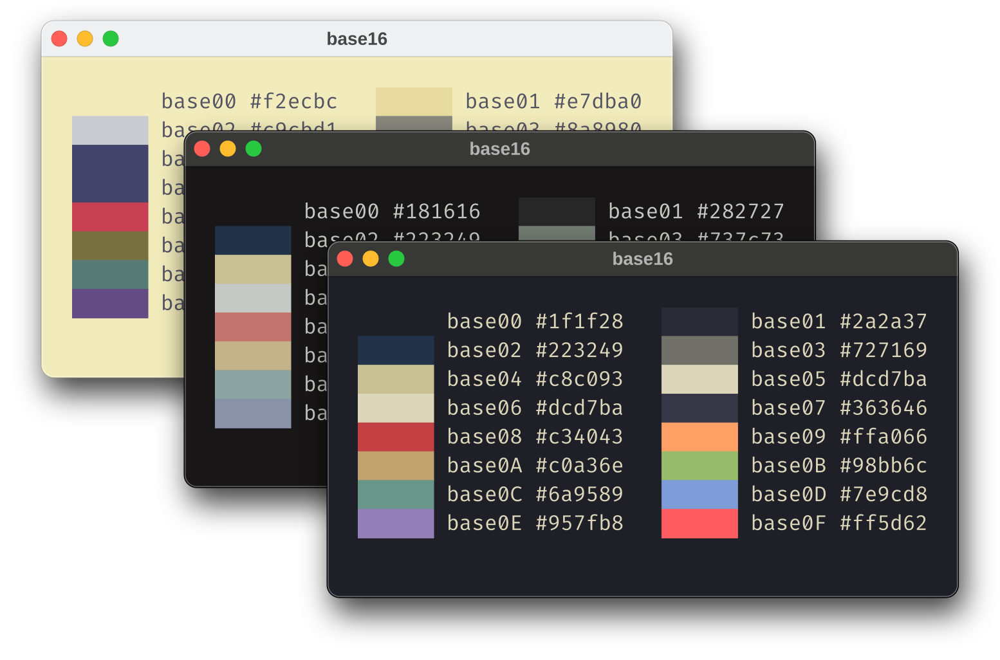
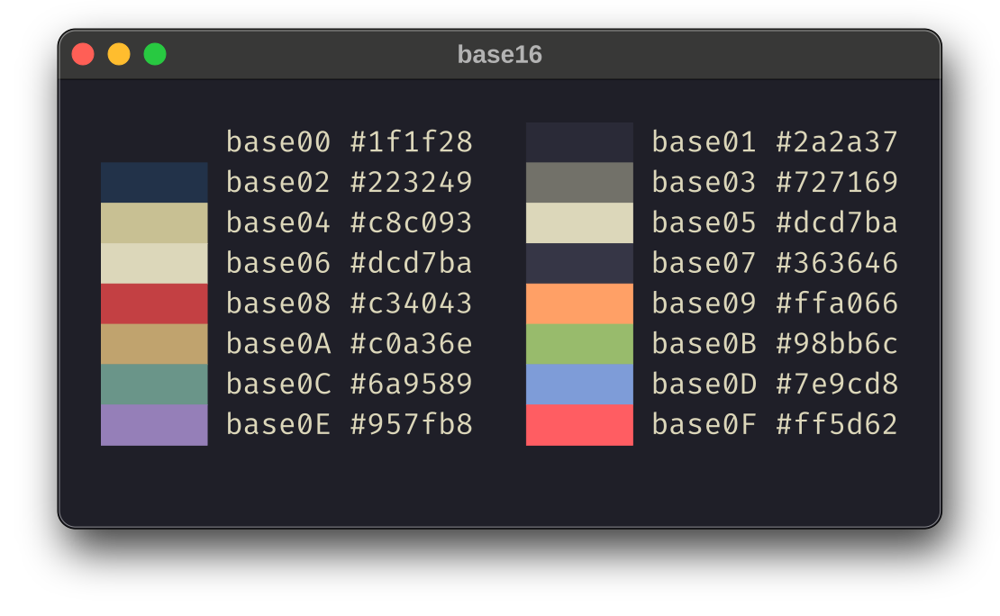
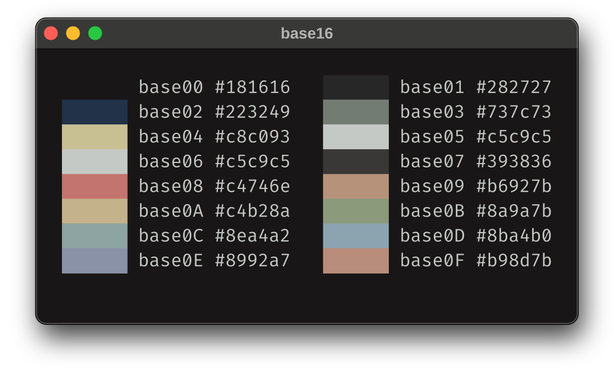
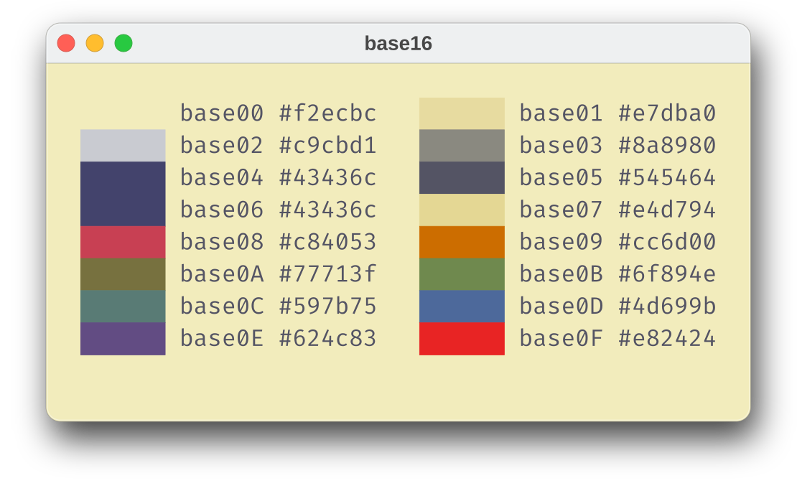

<h3>Kanagawa for <a href="https://github.com/tinted-theming/home">Base16</a></h3>

A community-maintained theme inspired by Hokusai's <em>The Great Wave off Kanagawa</em>.

Using the <a href="https://github.com/rebelot/kanagawa.nvim">Kanagawa palette</a> by <a href="https://github.com/rebelot">Tommaso Laurenzi (rebelot)</a>.

<!-- Wave accents: carpYellow, crystalBlue, autumnRed. Lotus accents: lotusYellow, lotusBlue4, lotusRed. -->

  <a href="https://github.com/kanagawa-community/base16/stargazers">
    <picture>
      <source media="(prefers-color-scheme: dark)" srcset="https://img.shields.io/github/stars/kanagawa-community/base16?style=for-the-badge&amp;labelColor=1F1F28&amp;color=E6C384">
      <source media="(prefers-color-scheme: light)" srcset="https://img.shields.io/github/stars/kanagawa-community/base16?style=for-the-badge&amp;labelColor=F2ECBC&amp;color=77713F">
      
    </picture>
  </a>
  <a href="https://github.com/kanagawa-community/base16/releases/latest">
    <picture>
      <source media="(prefers-color-scheme: dark)" srcset="https://img.shields.io/github/v/release/kanagawa-community/base16?style=for-the-badge&amp;label=release&amp;labelColor=1F1F28&amp;color=7E9CD8">
      <source media="(prefers-color-scheme: light)" srcset="https://img.shields.io/github/v/release/kanagawa-community/base16?style=for-the-badge&amp;label=release&amp;labelColor=F2ECBC&amp;color=4D699B">
      
    </picture>
  </a>
  <a href="https://github.com/kanagawa-community/base16/issues">
    <picture>
      <source media="(prefers-color-scheme: dark)" srcset="https://img.shields.io/github/issues/kanagawa-community/base16?style=for-the-badge&amp;labelColor=1F1F28&amp;color=C34043">
      <source media="(prefers-color-scheme: light)" srcset="https://img.shields.io/github/issues/kanagawa-community/base16?style=for-the-badge&amp;labelColor=F2ECBC&amp;color=C84053">
      
    </picture>
  </a>

 
 

## Previews

🌊 Wave

🐉 Dragon

🪷 Lotus

## Requirements

- A Base16 builder or app that reads the `system: base16` scheme format, such as [tinty](https://github.com/tinted-theming/tinty).

## Installation

Download the theme for your variant from [`themes/`](themes/), then add it to your builder's scheme folder.

## Usage

Build or apply the scheme with your builder. With tinty, copy the scheme to its custom scheme folder and run `tinty apply base16-kanagawa-wave`.

## Palette

Every color comes from the shared
[palette](https://github.com/kanagawa-community/.github/blob/main/docs/PALETTE.md),
picked by role, so each variant uses its own value for the same role.

| Base16 color | Palette role        |
| ------------ | ------------------- |
| `base00`     | `ui.bg`             |
| `base01`     | `ui.bg_p1`          |
| `base02`     | `ui.bg_visual`      |
| `base03`     | `syn.comment`       |
| `base04`     | `ui.fg_dim`         |
| `base05`     | `ui.fg`             |
| `base06`     | `term.bright_white` |
| `base07`     | `ui.bg_p2`          |
| `base08`     | `term.red`          |
| `base09`     | `syn.constant`      |
| `base0A`     | `term.yellow`       |
| `base0B`     | `syn.string`        |
| `base0C`     | `term.cyan`         |
| `base0D`     | `syn.fun`           |
| `base0E`     | `syn.keyword`       |
| `base0F`     | `term.extended_2`   |

## Credits

This port replaces the Base16 theme in the `extras` folder of the
[Neovim plugin](https://github.com/kanagawa-community/neovim). montdor first contributed that theme to kanagawa.nvim, and Lenny Lizowzskiy added Dragon. The
colors come from [kanagawa.nvim](https://github.com/rebelot/kanagawa.nvim) by
Tommaso Laurenzi.

## Issues and contributions

Report bugs and request changes in this port's
[issue tracker](https://github.com/kanagawa-community/base16/issues). Contributions are welcome.

See [CONTRIBUTING.md](CONTRIBUTING.md) before opening a pull request.

## License

MIT. See [LICENSE](LICENSE).
